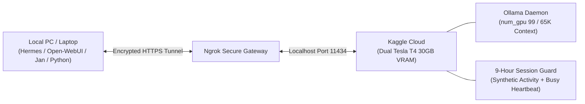

# Run Uncensored 31B LLMs Locally on PC with Free Kaggle Dual T4 GPUs

Run massive uncensored LLMs (Gemma 4 31B, Qwen 3.8 27B, Muse 30B) directly on your local PC or laptop with **0 local GPU VRAM** by offloading compute to free Kaggle Dual Tesla T4 GPUs (30 GB combined VRAM).

---

## Architecture Overview



---

## Why This Setup?

- **Zero Local Hardware Requirement**: Runs 27B-31B parameter models even on a standard 8GB RAM ultrabook.
- **30 GB GPU VRAM for Free**: Dual NVIDIA Tesla T4 GPUs on Kaggle provide full FP16/Q4 offload and massive context windows (65,536 - 131,072 tokens).
- **No 40-Minute Idle Shutdowns**: Built-in 9-hour dual-layer keep-alive guard keeps the kernel actively executing and simulates browser interaction.
- **Bypasses Kaggle 20 GB Disk Limit**: Weights are downloaded directly into the 73 GB `/tmp/models` partition via 16-connection multi-threaded `aria2c`.
- **OpenAI-Compatible `/v1` Endpoint**: Plug directly into Hermes Agent, Open-WebUI, LM Studio, AnythingLLM, Cursor, Continue.dev, or Python `openai` library.

---

## Supported Pre-Configured Models

| Model | Parameters | Quantization | Context Window | Repository |
|---|---|---|---|---|
| **Gemma 4 IT Uncensored Heretic** | 31 Billion | Q4_K_M (17.5 GB) | 65,536 tokens | `llmfan46/gemma-4-31B-it-uncensored-heretic-GGUF` |
| **Qwen 3.8 Heretic Abliterated** | 27 Billion | Q4_K_M (16.5 GB) | 65,536 tokens | `0bserverx/Qwen3.8-27B-Heretic-Abliterated-Uncensored-GGUF` |
| **Muse Glimmer Agentic** | 30 Billion | Q4_K_M (16.75 GB) | 65,536 - 131,072 tokens | `meta-models/Muse-Glimmer-30B-GGUF` |

---

## Quick Start (3 Steps)

### Step 1: Create a Kaggle Notebook
1. Go to `kaggle.com/code/new`.
2. In the right sidebar under **Session options**:
   - Set **Accelerator** to **GPU T4 x2**.
   - Ensure **Internet** is toggled **ON**.

### Step 2: Paste & Run the Unified Setup Cell
Copy the contents of `scripts/kaggle_universal_template.py` (or individual model scripts in `scripts/`) into Cell 1 of your notebook.

Configure your Ngrok credentials:
```python
NGROK_AUTHTOKEN = "YOUR_NGROK_TOKEN"
NGROK_DOMAIN = "your-domain.ngrok-free.dev" # Optional static domain
```

Click **Run Cell**. Within minutes:
- Dependencies (`aria2`, `pyngrok`, `ollama`) will be installed.
- Model weights (16.5 GB+) will download via 16 parallel threads.
- Ollama will launch on both T4 GPUs.
- Your public OpenAI-compatible URL will be printed on screen:
  ```text
  PUBLIC NGROK ENDPOINT: https:your-domain.ngrok-free.dev
  OPENAI COMPATIBLE BASE URL: https:your-domain.ngrok-free.dev/v1
  ```

### Step 3: Connect from Your Local PC

#### Option A: Hermes Agent
Add this to your local `~/.hermes/config.yaml`:
```yaml
model:
  default: "gemma4-heretic:31b"
  provider: "custom"
  base_url: "https:your-domain.ngrok-free.dev/v1"
  context_length: 65536
  ollama_num_ctx: 65536
```

#### Option B: Open-WebUI or LM Studio
- **API Base URL**: `https:your-domain.ngrok-free.dev/v1`
- **API Key**: `ollama` (or any string)
- **Model**: `gemma4-heretic:31b`

#### Option C: Python Script
Run the included test script:
```bash
python client/test_connection.py
```

---

## Repository Structure

```text
kaggle/
├── README.md                              # Complete setup & video reference guide
├── LICENSE                                # MIT License
├── .gitignore                             # Python & Jupyter cache exclusions
├── scripts/
│   ├── kaggle_universal_template.py       # All-in-one multi-model runner
│   ├── kaggle_gemma4_31b.py               # Dedicated Gemma 4 31B Heretic pipeline
│   ├── kaggle_qwen3.8_27b.py              # Dedicated Qwen 3.8 27B Heretic pipeline
│   └── kaggle_muse_glimmer_30b.py         # Dedicated Muse Glimmer 30B pipeline
└── client/
    ├── test_connection.py                 # Local PC verification script
    └── hermes_config_example.yaml         # Hermes Agent configuration template
```

---

## How the 9-Hour Keep-Alive Guard Works

Kaggle normally terminates notebook sessions after **40 minutes** of idle time or inactivity. This repository solves this using a two-tier mechanism:

1. **Frontend Tab Guard (JavaScript)**: Injects an active DOM script that simulates synthetic user interaction (`mousemove` events) every 25 seconds, preventing Kaggle's frontend disconnect timer from triggering.
2. **Backend Kernel Daemon (Python)**: An infinite non-blocking heartbeat loop flushes status metrics to stdout every 30 seconds. Because the kernel is constantly producing output, Kaggle registers the session as continuously active, allowing it to stay alive for its full 9-hour maximum GPU quota.

---

## License

MIT License. Free for personal, commercial, and research use.
